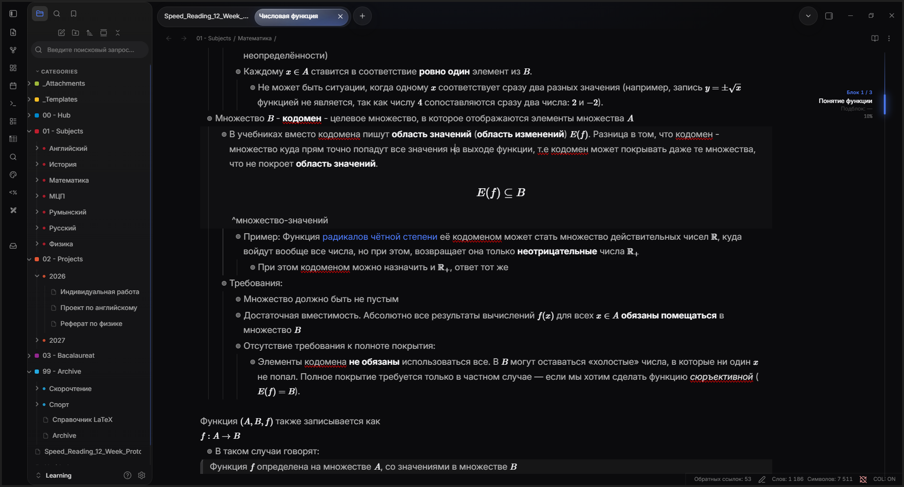
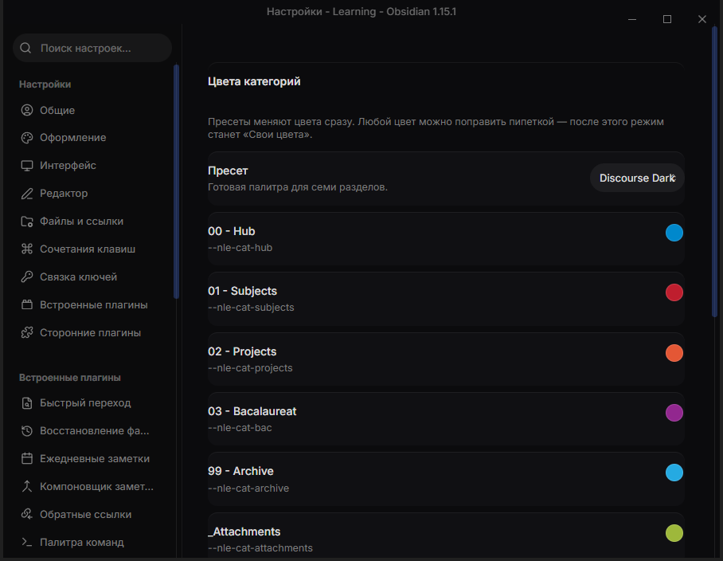

# Discourse for Obsidian

[Русская документация](README.md)

A dark Obsidian theme built around the visual language of Discourse: the
palette, icons, sidebar, typography and a right-hand block timeline. The
companion plugin adds liquid-glass tabs, category color presets and the
timeline.





## Features

- **Dark palette**: background `#0b0b0d`, text `#dadadb`, accent `#4e7dff`.
- **Forum-style sidebar**: a `CATEGORIES` label, colored section squares,
  subfolder dots and document icons for notes.
- **Liquid-glass tabs**: the active tab is a floating glass pill that flows
  smoothly between tabs.
- **Right-hand block timeline**: shows the main block, sub-block, `N / M`
  counters and scroll percentage. The strip is clickable along its full height;
  the mouse wheel over it scrolls the note.
- **Every note and split**: the timeline is mounted in every visible markdown
  pane.
- **Full width**: the theme respects Obsidian's `Readable line length` setting.
  When it is off, text is not locked into a centered rectangle.
- **Category colors**: seven presets plus a color picker per folder.
- **Details**: aligned header buttons, fixed `Ctrl+F` search spacing, centered
  toggle checkboxes, Inter + JetBrains Mono, styled tables, callouts,
  `<details>`, code blocks and quotes.

## Installation

### Windows — one command

Open PowerShell **in the vault root** (the folder that contains `.obsidian`)
and run:

```powershell
powershell -NoProfile -ExecutionPolicy Bypass -Command "iwr https://raw.githubusercontent.com/ZekiTRR/Discourse-obsidian/main/install.ps1 -UseBasicParsing | iex"
```

Or pass the vault path explicitly:

```powershell
powershell -NoProfile -ExecutionPolicy Bypass -File .\install.ps1 -VaultPath "C:\Users\You\Documents\MyVault"
```

The script downloads the latest release, installs the theme into
`.obsidian/themes/Discourse`, the plugin into
`.obsidian/plugins/discourse-theme-settings`, enables the plugin in
`community-plugins.json` and selects the theme in `appearance.json`.

### macOS / Linux

```bash
bash <(curl -fsSL https://raw.githubusercontent.com/ZekiTRR/Discourse-obsidian/main/install.sh) "/path/to/your/vault"
```

Requires `curl` and `unzip`; `python3` is used to enable the plugin
automatically.

### Manual

1. Open [Releases](https://github.com/ZekiTRR/Discourse-obsidian/releases).
2. Download:
   - `Discourse.zip`
   - `discourse-theme-settings.zip`
3. Extract:
   - `Discourse/` → `<vault>/.obsidian/themes/Discourse/`
   - `discourse-theme-settings/` → `<vault>/.obsidian/plugins/discourse-theme-settings/`
4. `Settings → Appearance → Themes → Discourse`.
5. `Settings → Community plugins` → enable **Discourse Theme Settings**.
6. Restart Obsidian.

> The release also contains `Discourse-obsidian.zip` with `themes/` and
> `plugins/` folders that can be extracted directly into `.obsidian/`.

## Settings

Open:

`Settings → Discourse Theme Settings`

or use the command palette:

`Discourse: Открыть настройки Discourse` (Open Discourse settings)

Available options:

- **Preset** — `Discourse Dark / Discord / GitHub / Cyberpunk / Pastel / Nord / Monochrome`.
- **Per-category color** — color picker.
- **Reset colors** — restore the default palette.
- **Liquid glass tabs** — on/off.
- **Block timeline** — on/off.
- **Space for timeline** — reserve a right-hand strip or let the timeline float
  over the text.

The settings labels in the current build are in Russian; the options above map
to them in order.

## Default category colors

| Folder | Color |
| --- | --- |
| `00 - Hub` | `#0088cc` |
| `01 - Subjects` | `#bf1e2e` |
| `02 - Projects` | `#e45735` |
| `03 - Bacalaureat` | `#92278f` |
| `99 - Archive` | `#25aae2` |
| `_Attachments` | `#9eb83b` |
| `_Templates` | `#fbbf24` |

Unknown vaults fall back to an `nth-child` color cycle; this vault uses explicit
`data-path` mappings.

## Repository layout

```
.
├── manifest.json                  # theme (the repo root is a valid theme)
├── theme.css
├── preview.png
├── settings.png
├── preview.html                   # interactive mockup
├── fonts/
│   ├── inter-var.woff2
│   └── JetBrainsMono-Regular.woff2
├── plugin/
│   └── discourse-theme-settings/
│       ├── manifest.json
│       └── main.js
├── install.ps1
├── install.sh
├── README.md                      # Russian documentation
├── README.en.md                   # English documentation
└── .github/workflows/release.yml
```

You can clone the repo root into `.obsidian/themes/Discourse`, but the release
archives are the recommended path.

## Requirements and compatibility

- Obsidian **1.5+**, tested on **1.15.1** (Windows).
- Desktop and mobile; on narrow panes the timeline yields to the native
  scrollbar.
- The theme is **dark by design**: it stays dark even when Obsidian is set to
  light mode.
- If another snippet or plugin overrides colors, disable it in
  `Settings → Appearance → CSS snippets`.
- The plugin is required for color presets, liquid-glass tabs and the timeline.
  Without it the theme still works, but these features are disabled.

## Theme mapping

| Discourse UI | Obsidian |
| --- | --- |
| `Main / Forum / Market / Help` pill navigation | Tab pill strip |
| `CATEGORIES` with colored squares | Folders with colored markers |
| Subcategories | Subfolder dots in the section color |
| Topic title | Note title |
| Post, quote, details, tables | Markdown styles |
| Right-hand topic timeline | Block timeline with labels |
| Dark glass panels | Glass panels, rings, blur |

## Licenses

- Theme and plugin code: [MIT](LICENSE).
- **Inter Variable** and **JetBrains Mono**: SIL Open Font License 1.1.
  Full text in [OFL.txt](OFL.txt); details in [FONTS.md](FONTS.md).

## Disclaimer

This project is inspired by the Discourse interface and is not an official
Discourse product. Names and color schemes are used as visual references.
