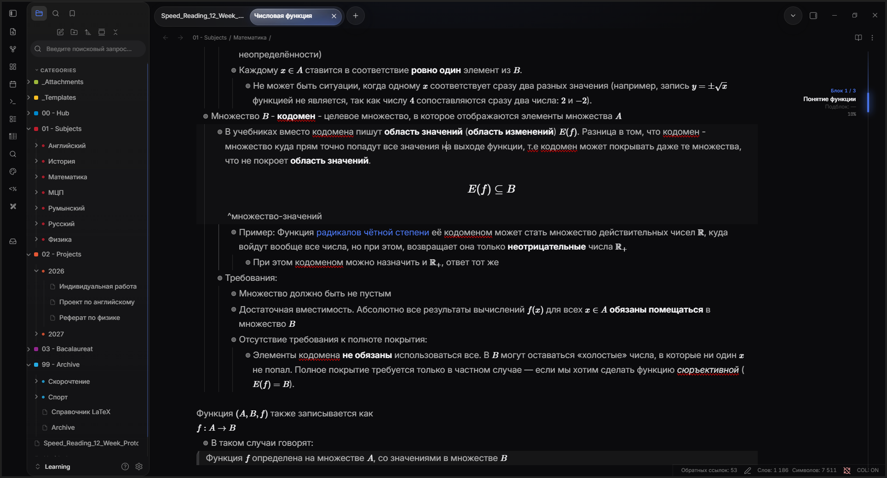
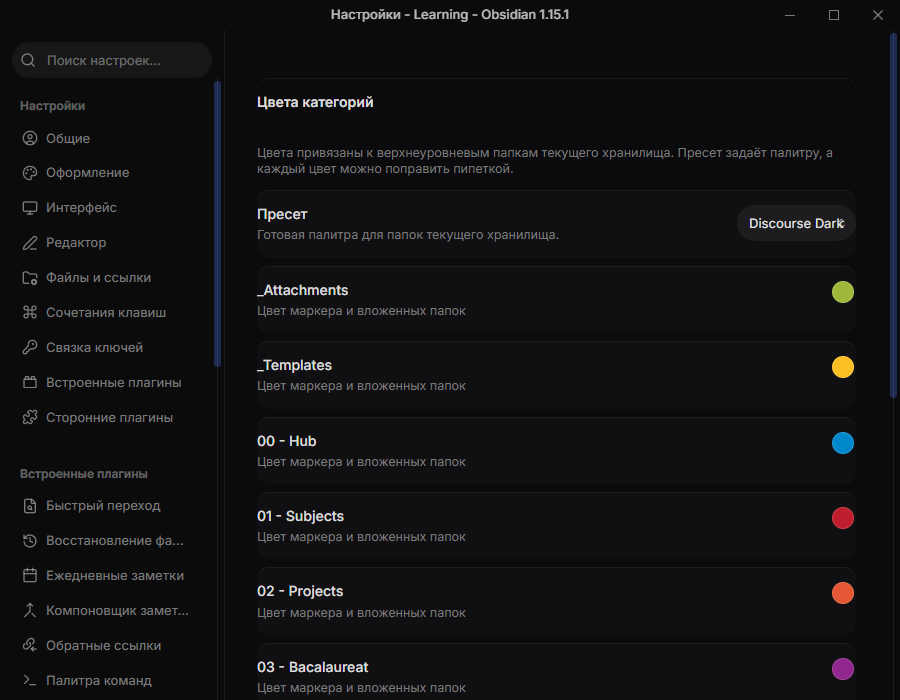

# Neverlose for Obsidian

Тёмная тема для Obsidian, собранная по визуальному языку форума
[forum.neverlose.cc](https://forum.neverlose.cc/) (Discourse). Плюс небольшой
плагин, который добавляет liquid-glass вкладки, настройку цветов категорий и
правый блок-таймлайн.





## Возможности

- **Цвета Neverlose**: фон `#0b0b0d`, текст `#dadadb`, акцент `#4e7dff`,
  оригинальные цвета Discourse-категорий.
- **Сайдбар как форум**: заголовок `CATEGORIES`, цветные квадраты разделов,
  точки подпапок, документ-иконки заметок.
- **Liquid-glass вкладки**: активная вкладка — плавающая стеклянная пилюля,
  которая плавно перетекает между вкладками.
- **Правый блок-таймлайн**: показывает главный блок, подблок, счётчики
  `N / M` и процент прокрутки. Полоса кликабельна по всей высоте; колесо мыши
  над ней прокручивает заметку.
- **Все заметки и сплиты**: таймлайн ставится в каждую видимую markdown-панель.
- **Полная ширина**: тема уважает настройку Obsidian
  `Readable line length`. Если она выключена, текст не запирается в
  центрированный прямоугольник.
- **Цвета категорий**: 7 пресетов + color picker для каждой папки.
- **Мелочи**: выровненные кнопки шапки, исправленный поиск `Ctrl+F`,
  центрированные toggle-чекбоксы, Inter + JetBrains Mono, стилизованные
  таблицы, callout, `<details>`, код и цитаты.

## Установка

### Windows — одной командой

Открой PowerShell **в корне vault** (папка, где лежит `.obsidian`) и выполни:

```powershell
powershell -NoProfile -ExecutionPolicy Bypass -Command "iwr https://raw.githubusercontent.com/ZekiTRR/Discourse-obsidian/main/install.ps1 -UseBasicParsing | iex"
```

Или явно укажи путь к vault:

```powershell
powershell -NoProfile -ExecutionPolicy Bypass -File .\install.ps1 -VaultPath "C:\Users\You\Documents\MyVault"
```

Скрипт скачает последний релиз, положит тему в
`.obsidian/themes/Neverlose`, плагин в
`.obsidian/plugins/neverlose-theme-settings`, включит плагин в
`community-plugins.json` и выставит тему в `appearance.json`.

### macOS / Linux

```bash
bash <(curl -fsSL https://raw.githubusercontent.com/ZekiTRR/Discourse-obsidian/main/install.sh) "/path/to/your/vault"
```

Нужны `curl` и `unzip`; для автоматического включения плагина — `python3`.

### Вручную

1. Открой [Releases](https://github.com/ZekiTRR/Discourse-obsidian/releases).
2. Скачай:
   - `Neverlose.zip`
   - `neverlose-theme-settings.zip`
3. Распакуй:
   - `Neverlose/` → `<vault>/.obsidian/themes/Neverlose/`
   - `neverlose-theme-settings/` → `<vault>/.obsidian/plugins/neverlose-theme-settings/`
4. `Settings → Appearance → Themes → Neverlose`.
5. `Settings → Community plugins` → включи **Neverlose Theme Settings**.
6. Перезапусти Obsidian.

> В релизе также есть `Neverlose-obsidian.zip`: внутри папки `themes/` и
> `plugins/`, которые можно распаковать прямо в `.obsidian/`.

## Настройка

Открой:

`Settings → Neverlose Theme Settings`

или найди в command palette:

`Neverlose: Открыть настройки Neverlose`

Там:

- **Пресет** — `Neverlose / Discord / GitHub / Cyberpunk / Pastel / Nord / Monochrome`.
- **Цвет каждой категории** — color picker.
- **Сбросить цвета** — вернуть оригинальную палитру.
- **Liquid glass вкладки** — включить/выключить.
- **Таймлайн блоков** — включить/выключить.
- **Место под таймлайн** — резервировать полосу справа или позволить
  таймлайну плавать поверх текста.

Цвета применяются сразу через CSS-переменные:
`--nle-cat-hub`, `--nle-cat-subjects`, `--nle-cat-projects`,
`--nle-cat-bac`, `--nle-cat-archive`, `--nle-cat-attachments`,
`--nle-cat-templates`.

## Структура репозитория

```
.
├── manifest.json                  # тема (корень репозитория — валидная тема)
├── theme.css
├── preview.png
├── settings.png
├── preview.html                   # интерактивный макет
├── fonts/
│   ├── inter-var.woff2
│   └── JetBrainsMono-Regular.woff2
├── plugin/
│   └── neverlose-theme-settings/
│       ├── manifest.json
│       └── main.js
├── install.ps1
├── install.sh
└── .github/workflows/release.yml
```

Корень можно склонировать прямо в `.obsidian/themes/Neverlose`, но проще
использовать релизные архивы.

## Требования и совместимость

- Obsidian **1.5+**, проверено на **1.15.1** (Windows).
- Desktop и mobile; на узких панелях таймлайн автоматически уступает место
  нативному скроллбару.
- Тема **тёмная по дизайну**: в светлом режиме Obsidian она остаётся тёмной.
- Если сторонний сниппет или плагин переопределяет цвета, отключи его в
  `Settings → Appearance → CSS snippets`.
- Плагин необходим для пресетов цветов, liquid-glass вкладок и таймлайна.
  Без него тема работает, но эти функции отключены.

## Что перенесено с форума

| Discourse / Neverlose | Obsidian |
| --- | --- |
| Пилл-навигация `Main / Forum / Market / Help` | Пилл-полоса вкладок |
| `CATEGORIES` с цветными квадратами | Папки с цветными маркерами |
| Подкатегории | Точки подпапок в цвете раздела |
| Тема форума | Заголовок заметки |
| Пост, цитата, details, таблицы | Markdown-стили |
| Правый таймлайн темы | Блок-таймлайн с подписями |
| Тёмные стеклянные панели | Glass-панели, ring, blur |

## Лицензии

- Код темы и плагина: [MIT](LICENSE).
- Шрифты **Inter Variable** и **JetBrains Mono**: SIL Open Font License 1.1.
  Полный текст — в [OFL.txt](OFL.txt), детали — в [FONTS.md](FONTS.md).

## Дисклеймер

Проект вдохновлён оформлением forum.neverlose.cc и не является официальным
продуктом Neverlose. Все названия и цветовые схемы использованы как
визуальный референс.

---

## English quick install

1. Download `Neverlose.zip` and `neverlose-theme-settings.zip` from
   [Releases](https://github.com/ZekiTRR/Discourse-obsidian/releases).
2. Extract them to `.obsidian/themes/Neverlose` and
   `.obsidian/plugins/neverlose-theme-settings`.
3. Enable **Neverlose** in `Settings → Appearance → Themes`.
4. Enable **Neverlose Theme Settings** in `Settings → Community plugins`.
5. Restart Obsidian.

Windows one-liner (run inside the vault folder):

```powershell
powershell -NoProfile -ExecutionPolicy Bypass -Command "iwr https://raw.githubusercontent.com/ZekiTRR/Discourse-obsidian/main/install.ps1 -UseBasicParsing | iex"
```
